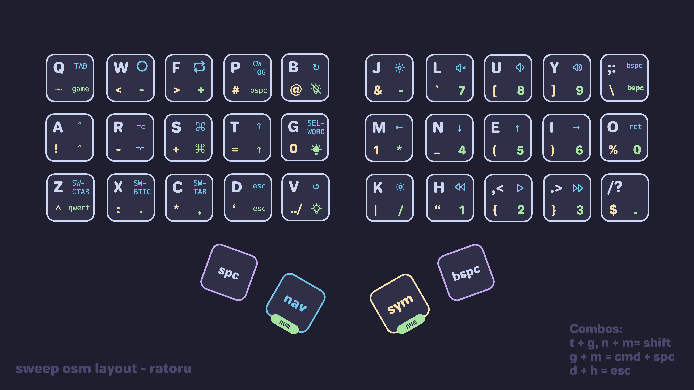
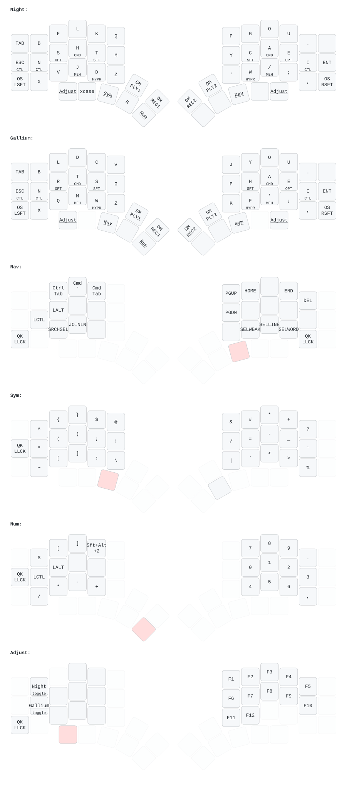
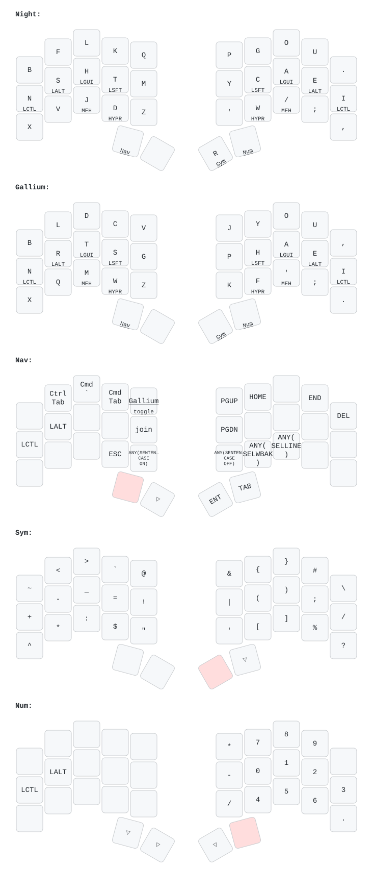
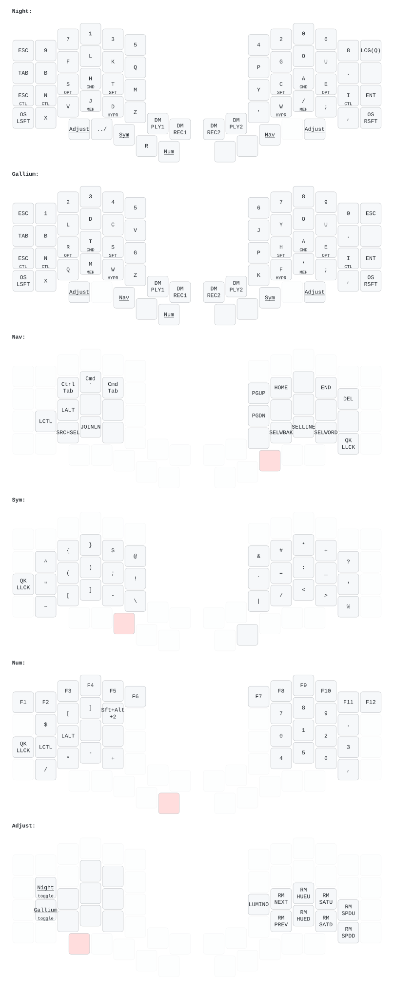
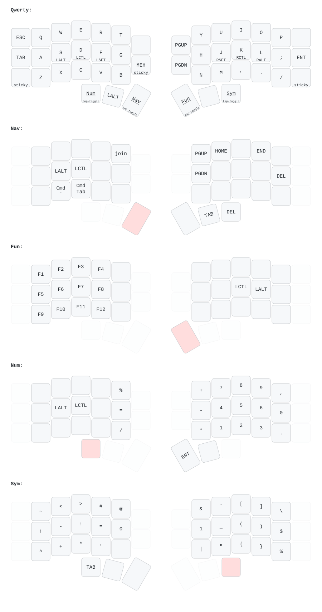

# My QMK Keymaps

These are my keymaps for the [Kyria rev3](https://github.com/splitkb/kyria), [Aurora Sweep](https://splitkb.com/collections/keyboard-kits/products/aurora-sweep), [Elora](https://splitkb.com/products/halcyon-elora) with a Halcyon display module, and Corne v4.1. Learn more about how and why I created them by reading [my guide](https://ratoru.com/blog/choose-the-right-base-layout).

Since I created my first keymap, a lot has changed in the keyboard layout space. The introduction of new evaluation metrics has led to much more optimized layouts than `Colemak-DH`, my original layout. The Kyria, Sweep and Elora now use `Night` as the base layer, with `Gallium` as an alternative default layer. To make these layouts work with German, I wrote a custom **magic key**. See the `Arcane` section for more.

I spent a lot of time trying to design a very efficient symbol layer for programming. To do so, I referred heavily to character and bigram frequencies in programming languages.

The firmware is compiled by a GitHub Action on every push, and can also be built locally. See below for both.



## Features

- Efficient symbol layer
- Home row mods, tuned with [Chordal Hold](https://docs.qmk.fm/tap_hold#chordal-hold) and [Flow Tap](https://docs.qmk.fm/tap_hold#flow-tap)
- Layer keys on the thumbs via layer-tap
- Hyper key to use as a "leader key" for global shortcuts
- Xcase key to type words like "hello_world" and "hello-world"
- Community modules from [getreuer](https://github.com/getreuer/qmk-modules), included as a submodule in `modules/getreuer`:
    - [Select Word](https://getreuer.info/posts/keyboards/select-word/index.html)
    - [Cyclotab](https://getreuer.info/posts/keyboards/cyclotab). Sends `Cmd+Tab` but holds the modifier between consecutive keypresses for easy app/window switching.
    - Sentence Case on the Sweep, and PaletteFX and Lumino on the RGB matrix boards (Elora, Corne).
- QMK Features:
    - [Dynamic Macros](https://docs.qmk.fm/features/dynamic_macros)
    - [Caps Word](https://docs.qmk.fm/features/caps_word), also turned on by double-tapping left shift.
    - [Layer Lock](https://docs.qmk.fm/features/layer_lock)
    - [Repeat Key](https://docs.qmk.fm/features/repeat_key) and Alt Repeat Key.
    - Different useful Macros around browser usage.
- RGB lighting:
    - Sweep: underglow with a different color for each layer.
    - Elora and Corne: [PaletteFX](https://getreuer.info/posts/keyboards/palettefx/index.html) effects.
    - Liatris boards (Kyria, Sweep): the microcontroller's power LED is turned off.

My keymap documentation might not always be up to date. Don't blindly trust the images.

### Arcane Key

My `ARCANE` key (Kyria) mixes the functionality of a **repeat key** and a **magic key**.

- If there is no custom functionality, the previous key will be repeated.
- One-shot shift after space, enter, or after keyboard idle.
- Outputs German Umlaute, using the `Option+U` dead key of the macOS US layout.
- Avoids difficult SFBs.
- Completes common trigrams (`ion` in English and `sch` in German).
- Outputs common words after shifted letters, e.g. `D->anke`, `T->hank`.
- Reverses the last shortcut, e.g. undo becomes redo and closing a tab reopens it.

The exact bindings can be found in `users/ratoru/features/arcane.c`.

### Sweep Magic Key

The Sweep has separate Repeat and Alt Repeat keys on its thumbs, using getreuer's [Alt Repeat Key](https://getreuer.info/posts/keyboards/repeat-key/index.html) approach to a magic key. The full table is at the top of the Sweep's `keymap.c`.

## Repository layout

- `users/ratoru/`: code shared by all keymaps: custom keycodes (`ratoru_keycodes.h`), `process_record_user` (`ratoru.c`), shared settings (`config.h`, `rules.mk`), and the Arcane feature.
- `keyboards/<keyboard>/keymaps/ratoru/`: one keymap per keyboard. Layers live in `keymap.json`. Keymap-specific code goes in an optional `keymap.c`, which can define `process_record_keymap()` to handle its own keycodes.
- `users/ratoru/keymap.h`: QMK includes this from the `keymap.c` it generates from `keymap.json`, which gives the JSON keymaps access to the userspace keycodes.
- `qmk.json`: the keymaps that CI and `qmk userspace-compile` build.

## How to build with GitHub

> [!NOTE]
> The Kyria and Sweep are compiled for the Liatris microcontroller using `CONVERT_TO = liatris` in their `rules.mk`. If you have a [different controller](https://docs.qmk.fm/feature_converters), you might want to change that!

✅ Easier. No setup required.

❌ Longer feedback loop. Changes need to go through CI.

1. Push your changes to the remote.

    ```sh
    git push origin main
    ```

2. Wait for the CI to pass. (A GitHub Action will build your firmware.)

    ```sh
    gh run watch
    ```

3. Grab the firmware from the CI artifacts.

    ```sh
    gh run download
    ```

    > ℹ️ Please note that these artifacts are ephemeral and they may be expired if you try to access them later on. You can always grab the latest firmware from the [Releases](https://github.com/ratoru/qmk_userspace/releases) page.

4. Flash the firmware to your keyboard. This depends on your microcontroller. If yours is RP2040 based, take a look at the section on flashing.

## How to build locally

1. Install the QMK CLI and the other tools with Homebrew, and the drawing tools with uv.

    ```sh
    brew bundle --file BREWFILE
    uv sync
    ```

2. Clone `qmk_firmware` and point it at this userspace.

    ```sh
    qmk setup -H ~/programming/keyboard/qmk_firmware
    qmk config user.overlay_dir="$(pwd)"
    ```

3. Build.

    ```sh
    just compile-all     # every keymap in qmk.json
    just compile sweep   # one keymap: corne, elora, kyria or sweep
    ```

Remember to update `qmk_firmware` periodically, including its submodules (`qmk git-submodule`).

## Flashing RP2040 microcontroller

> [!WARNING]
> Please always unplug your keyboard from your computer **before** removing the TRRS cable
> to prevent short-circuiting your board!

- Disconnect TRRS/TRS cable between the splits (keyboard halves).
- For each split, do:
    - Connect your split to the computer using USB.
    - Press the reset switch of the split twice. Your RP2040 based MCU will go into Bootloader Mode.
    - Your device should appear as a Mass Storage Device. You can also see Raspberry PI Boot Device in the output of lsusb.
    - Drag and Drop (cp or copy) the `.uf2` file to the RP2040 Mass Storage Device.
    - After the firmware is copied, you will see that the MCU exits Bootloader mode and Mass Storage Device is no longer present. It means that the firmware is flashed!
- After flashing both halves, disconnect your half, reconnect the halves with the TRRS cable, and plug your keyboard back in. Enjoy!

## Drawing your keymap

Drawing your keymap can really help you memorize the different layers. Furthermore, it lets others discover your keymap more easily.

I use [keymap-drawer](https://github.com/caksoylar/keymap-drawer), configured in `drawer_config.yaml`. The drawings in `docs/generated` are redrawn by a pre-commit hook, or manually:

```bash
just draw sweep   # one keymap
just draw-all     # every keymap
```

## My keymaps in detail

### Kyria



### Sweep



### Elora



### Corne v4.1



## Setting up your LSP

To make your LSP pick up the correct imports, run `just compile <keyboard>`. It writes a `compile_commands.json` that `clangd` uses for the keymap you are currently working on. Run it again when you switch to a different keymap.
